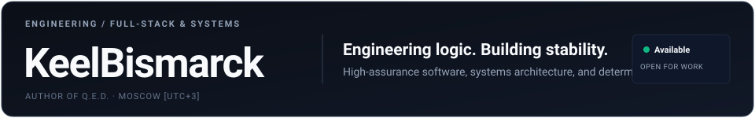
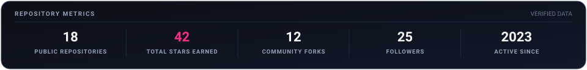

  

  
  
  
  
  

---

## Featured Work

- **[Q.E.D. (`qed-standard`)](https://github.com/keelbismark/qed)**  
  High-assurance engineering standard and zero-dependency verification CLI for AI coding agents. Enforces pre-flight checks, TDD, secret leak defense, and visual anti-slop across 20+ development environments (`npx qed-standard check`).
- **[OpenAntigravity](https://github.com/keelbismark/OpenAntigravity)**  
  Portable utility written in Rust designed for Google Antigravity (IDE & CLI) enabling seamless offline and network-resilient workflows.
- **High-Throughput Backend & Systems Engineering**  
  Deterministic architecture, concurrency, and low-latency services with Python, TypeScript, C++, and Go.

---

## Core Stack

| Domain | Technologies | Focus |
| :--- | :--- | :--- |
| **Systems & Logic** | Python, C++, Java, Bash, Rust | Concurrency, systems programming, backend logic, automated tooling |
| **Services & Web** | TypeScript, Node.js, Flask, Spring Boot, Electron | High-throughput APIs, desktop applications, real-time protocols |
| **Infrastructure & Storage** | PostgreSQL, MySQL, SQLite, Docker, Nginx | Schema design, container workflows, reverse proxy configuration |
| **Environments** | Arch Linux, Windows 11, macOS | Unix-native toolchains, cross-platform compilation and deployment |

---

## Workstation Specifications

| Component | Specification |
| :--- | :--- |
| **CPU** | Intel Core i9-14900KF (24 Cores / 32 Threads @ up to 6.0 GHz) |
| **GPU** | NVIDIA GeForce RTX 4070 Ti SUPER (16 GB GDDR6X) |
| **Memory** | 80 GB DDR5 High-Speed Dual-Channel |
| **Primary OS** | Arch Linux x86_64 / Windows 11 Pro (Dual Boot) |
| **Tooling** | Neovim, VS Code, Cursor, zsh |

---

## Repository Telemetry

<!-- AUTO:START -->

  

  

<!-- regenerated: 2026-11-22 -->
<!-- AUTO:END -->

---

> [!NOTE]
> **Engineering Thesis:**  
> *"Engineering logic. Building stability."*  
> Evidence before assertions. Prioritizing deterministic control flow, low cognitive overhead, and maintainable software architecture.

  Maintained by <a href="https://github.com/keelbismark"><b>@keelbismark</b></a> · Automated via GitHub Actions

