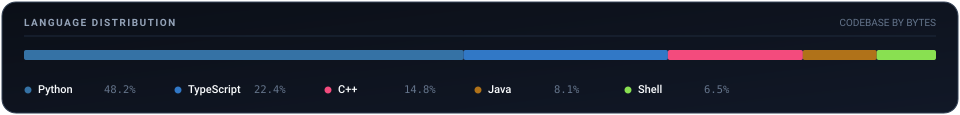

  

  
  
  
  

---

### Core Engineering Focus

> [!NOTE]
> **Deterministic logic. Low latency. Zero compromise.**  
> Focused on building fault-tolerant backend architectures, systems-level tooling, and high-throughput pipelines. I prioritize memory safety, cache locality, and explicit error handling over bloated abstractions.

---

### Architectural Matrix & Technical Arsenal

| Domain | Core Stack | Architectural Focus |
| :--- | :--- | :--- |
| **Low-Level & Systems** | `Rust`, `C++`, `Java`, `Bash` | Memory-efficient services, concurrent actors, Linux kernel interfaces, CLI utilities |
| **High-Load Backend** | `Python`, `FastAPI`, `Node.js`, `TypeScript` | Asynchronous microservices, high-throughput REST / WebSocket APIs, event loops |
| **Data & Persistence** | `PostgreSQL`, `Redis`, `MySQL`, `SQLite` | ACID transactions, in-memory caching, indexing strategies, distributed data storage |
| **Infrastructure & CI/CD** | `Docker`, `Nginx`, `Git`, `GitHub Actions` | Reproducible container runtimes, reverse proxies, automated testing & deployment |
| **Client & Native** | `Electron`, `React / Modern Web` | Desktop tooling, responsive telemetry dashboards, developer interfaces |

---

### Primary Workstation

  

---

### Dynamic Profile Telemetry

<!-- AUTO:START -->

  

  

<!-- regenerated: 2026-11-19 -->
<!-- AUTO:END -->

---

<b>Communications &amp; Service Level Agreement (SLA)</b>

 

- **Primary Direct Channel:** Telegram ([@bismark_dev](https://t.me/bismark_dev)) for real-time discussions, contract inquiries, and architectural consulting.
- **Formal Contact:** [contact@keelbismark.space](mailto:contact@keelbismark.space)
- **Timezone:** Moscow · UTC+3
- **Guaranteed Response SLA:** Under 24 hours for verified inquiries.

  Constructed with precision · Autonomously updated via GitHub Actions

